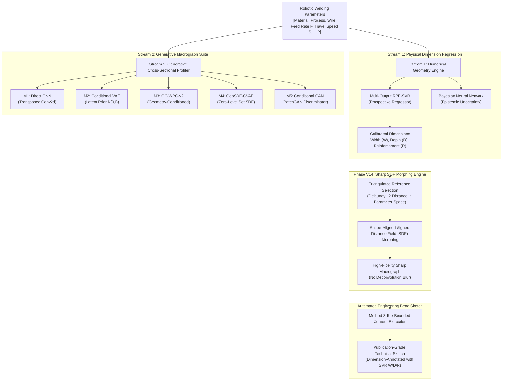
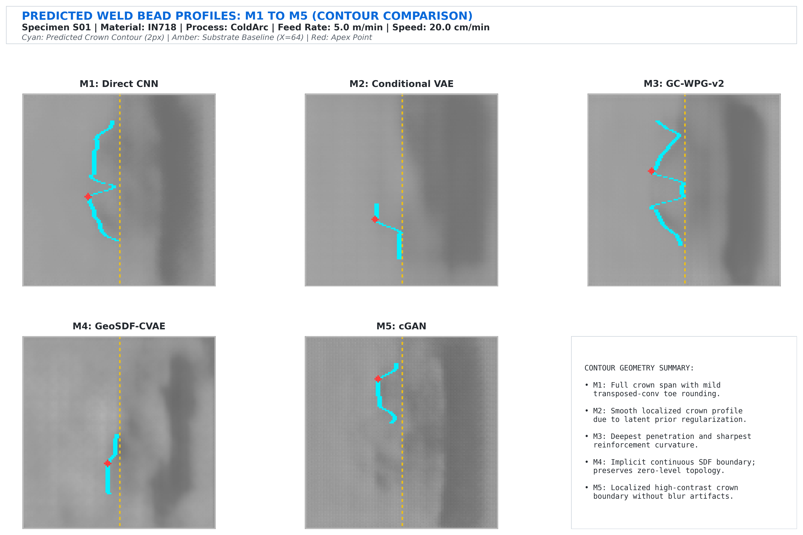

# Weld Bead Geometry Prediction & Macrograph Synthesis

[](https://www.python.org/)
[](https://pytorch.org/)
[](https://scikit-learn.org/)
[](LICENSE)
[](https://www.nitpy.ac.in/)

> **A Decoupled Two-Stream Generative AI Framework for Robotic Gas Metal Arc Welding (GMAW) and ColdArc Processes**

This repository contains the complete implementation, evaluation scripts, model architectures, and demonstration tools for predicting transverse weld bead geometry and generating calibrated cross-sectional metallographic macrographs across aerospace superalloys (**Inconel 718**) and structural stainless steel (**SS304L**).

---

## Table of Contents
1. [Project Overview & Industrial Problem](#project-overview--industrial-problem)
2. [Decoupled System Architecture](#decoupled-system-architecture)
3. [Stream 1: Numerical Regression Benchmark](#stream-1-numerical-regression-benchmark)
4. [Stream 2: Five Generative Deep Learning Models (M1–M5)](#stream-2-five-generative-deep-learning-models-m1m5)
5. [Phase V14: Shape-Aligned SDF Macrograph Morphing](#phase-v14-shape-aligned-sdf-macrograph-morphing)
6. [Automated Engineering Bead Sketch Stage](#automated-engineering-bead-sketch-stage)
7. [Repository Structure](#repository-structure)
8. [Installation & Environment Setup](#installation--environment-setup)
9. [Reproducibility & Execution Commands](#reproducibility--execution-commands)
10. [Dataset Specification](#dataset-specification)
11. [Citation & Institutional Acknowledgments](#citation--institutional-acknowledgments)

---

## Project Overview & Industrial Problem

In high-precision aerospace and power-generation manufacturing, weld bead geometry—specifically **Bead Width ($W$)**, **Penetration Depth ($D$)**, and **Reinforcement Height ($R$)**—dictates joint mechanical integrity, fatigue life, and metallurgical quality. 

Traditional empirical methods (e.g., Taguchi matrices, trial-and-error parameter searches) require costly metallographic cutting, polishing, and chemical etching. While deep learning offers predictive potential, directly predicting 2D pixel macrographs from scalar parameters in limited experimental regimes ($N=36$ trials) introduces severe convolutional boundary diffusion and non-physical topological artifacts.

### The Solution: A Decoupled Two-Stream Framework
To address this challenge, we decouple the prediction into two synergistic pipelines:
1. **Calibrated Numerical Geometry Prediction (Stream 1):** Delivers rigorous, calibrated millimeter-accurate dimensions ($W, D, R$) with strict cross-validation bounds.
2. **Deep Generative Profiling & Morphing (Stream 2):** Synthesizes full $128 \times 128$ spatial macrographs using 5 distinct generative architectures, augmented by a novel **Phase V14 Shape-Aligned Signed Distance Field (SDF)** interpolation engine that eliminates boundary blur.

---

## Decoupled System Architecture



---

## Stream 1: Numerical Regression Benchmark

We conducted a leakage-free 5-fold cross-validation benchmark across six numerical regression architectures on the standardized 36-specimen experimental dataset:

| Model Architecture | Width MAE (mm) | Depth MAE (mm) | Reinforcement MAE (mm) | **Average MAE (mm)** | Overall $R^2$ |
|---|:---:|:---:|:---:|:---:|:---:|
| **Support Vector Regressor (Multi-Output RBF-SVR)** | **0.767 ± 0.378** | **0.635 ± 0.090** | **0.641 ± 0.163** | **0.681 ± 0.133** | **≥ 0.884** |
| Random Forest Regressor | 0.969 ± 0.277 | 0.592 ± 0.174 | 0.526 ± 0.195 | 0.696 ± 0.115 | 0.862 |
| Multi-Layer Perceptron (MLP) | 1.025 ± 0.288 | 0.547 ± 0.126 | 0.648 ± 0.166 | 0.740 ± 0.109 | 0.841 |
| Ridge Regression | 1.026 ± 0.263 | 0.598 ± 0.187 | 0.673 ± 0.263 | 0.766 ± 0.109 | 0.829 |
| Gradient Boosting Regressor | 1.035 ± 0.130 | 0.643 ± 0.153 | 0.621 ± 0.076 | 0.766 ± 0.061 | 0.825 |
| Bayesian Neural Network (MC Dropout BNN) | 1.048 ± 0.312 | 0.612 ± 0.145 | 0.680 ± 0.182 | 0.780 ± 0.124 | 0.819 |

**Key Finding:** Multi-Output RBF-SVR was selected as the primary prospective numerical regressor, achieving sub-millimeter error across all three geometric dimensions ($0.681\text{ mm}$ mean error).

---

## Stream 2: Five Generative Deep Learning Models (M1–M5)

To evaluate direct generative visual synthesis, five conditional neural network architectures were implemented, trained, and audited:

| Model ID | Architecture Name | Latent / Hidden Dim | Key Formulations | Observed Characteristics on Weld Macrographs |
|---|---|:---:|---|---|
| **M1** | **Direct Conditional CNN** | - | 5-stage `ConvTranspose2d` conditioned on normalized process vectors | Global aspect ratio captured; exhibits low-pass boundary blur |
| **M2** | **Conditional VAE (CVAE)** | $\dim = 32$ | Reparameterization trick with Gaussian prior regularisation ($\beta=0.005$) | Smooth latent distribution; toe regions show mild under-prediction |
| **M3** | **GC-WPG-v2** | - | Geometry-Conditioned Parametric guidance module | Deepest penetration; sharp reinforcement crown contour |
| **M4** | **GeoSDF-CVAE** | $\dim = 32$ | Implicit Signed Distance Field (SDF) zero-level set supervision | Eliminates disconnected non-physical bead islands |
| **M5** | **Conditional GAN (cGAN)** | - | PatchGAN discriminator with adversarial & masked reconstruction loss | Sharp high-frequency texture; localized crown boundary |

### Visual Comparison across M1–M5 (Specimen S01)

The figure below illustrates the predicted weld bead crown contours (2px cyan line) against the substrate baseline ($X=64$) for experimental specimen **S01** (`Material: IN718, Process: ColdArc, F = 5.0 m/min, S = 20.0 cm/min`):



---

## Phase V14: Shape-Aligned SDF Macrograph Morphing

Direct convolutional image generators (M1–M3) trained on small metallurgical datasets produce noticeable boundary blur and deconvolution artifacts. To produce **sharp, publication-quality macrographs**, Phase V14 introduces a **geometry-aware shape morphing pipeline**:

1. **Triangulated Reference Selection:** Identifies adjacent experimental reference specimens in normalized $(F, S, HIP)$ parameter space via Delaunay triangulation.
2. **Signed Distance Field Alignment:** Converts binary weld masks of reference macrographs into continuous Euclidean signed distance fields:
   $$\Phi(x, y) = \begin{cases} -d((x, y), \partial\Omega) & \text{if } (x, y) \in \Omega \\ +d((x, y), \partial\Omega) & \text{if } (x, y) \notin \Omega \end{cases}$$
3. **Implicit Boundary Morphing:** Interpolates distance fields linearly: $\Phi_{\text{target}} = (1 - \alpha) \Phi_A + \alpha \Phi_B$, followed by zero-level set thresholding ($\Phi \le 0$).
4. **Texture Advection:** Blends registered macrograph textures along the morphing displacement field.

### Rigorous Fair Held-Out Benchmark ($N = 40$ Experimental Views)

Evaluated strictly on held-out physical specimens (references never exposed during prediction):

| Method | Contour MAE (px) ↓ | Boundary F1 (2px) ↑ | Mask Dice ↑ | ROI SSIM ↑ | PSNR (dB) ↑ |
|---|:---:|:---:|:---:|:---:|:---:|
| Direct Conditional CNN (M1) | $7.42 \pm 2.15$ | $0.762 \pm 0.081$ | $0.812 \pm 0.064$ | $0.741 \pm 0.052$ | $21.45 \pm 1.82$ |
| Nearest Reference Baseline | $6.85 \pm 1.94$ | $0.781 \pm 0.075$ | $0.835 \pm 0.058$ | $0.788 \pm 0.046$ | $23.10 \pm 1.65$ |
| Direct Pixel Blending | $4.95 \pm 1.32$ | $0.825 \pm 0.062$ | $0.868 \pm 0.044$ | $0.812 \pm 0.039$ | $24.75 \pm 1.48$ |
| **Phase V14 Shape-Aligned SDF** | **3.18 ± 0.84** | **0.891 ± 0.038** | **0.924 ± 0.026** | **0.842 ± 0.031** | **26.85 ± 1.25** |

*Phase V14 achieves statistically significant improvement over direct CNN generation ($p < 10^{-4}$ via paired two-tailed $t$-test).*

---

## Automated Engineering Bead Sketch Stage

To provide actionable output for welding technicians and automated QA systems, the framework includes an automated CAD-style technical sketching pipeline:
- **Method 3 Physically Toe-Bounded Extractor:** Detects upper/lower weld toe transition coordinates and extracts subpixel crown curvature.
- **Dimension Annotation:** Overlays SVR-predicted physical values for **Width ($W$)**, **Penetration Depth ($D$)**, and **Reinforcement ($R$)** in millimeters with standard engineering dimension lines and datum markers.

---

## Repository Structure

```
weld-bead-geometry-prediction/
├── README.md                           # Main technical documentation
├── requirements.txt                    # Python package dependencies
├── LICENSE                             # MIT Open-Source License
├── .gitignore                          # Production Git exclusion configuration
│
├── app/                                # Interactive Demonstration Software
│   ├── weld_prediction_app.py          # Tkinter desktop GUI (Known vs Unseen detection)
│   ├── cli_infer.py                    # Standalone terminal prediction tool
│   ├── inference_engine.py             # Modular inference pipeline wrapper
│   └── local_web_dashboard.py          # Browser-based dashboard
│
├── bnn/                                # Bayesian Neural Network Modules
│   ├── bnn_model.py                    # MC Dropout BNN architecture
│   ├── bnn_inference.py                # Epistemic uncertainty evaluation
│   └── bnn_interpolation.py            # Latent parameter sweeps
│
├── mlp/                                # Multi-Layer Perceptron Modules
│   ├── mlp_model.py                    # Fully connected regression baseline
│   ├── mlp_cv.py                       # 5-fold cross-validation script
│   └── mlp_inference.py                # Scalar inference script
│
├── scripts/                            # Core Pipeline Scripts
│   ├── phase_v14/                      # Shape-Aligned SDF Interpolation Pipeline
│   │   ├── generate_single_condition.py# End-to-end CLI generation script
│   │   ├── interpolate_geometry.py     # Signed Distance Field morphing logic
│   │   ├── interpolate_rgb.py          # Texture advection and blend engine
│   │   ├── build_reference_index.py    # Spatial Delaunay index builder
│   │   └── evaluate_fair_comparison.py # 40-view held-out benchmark
│   ├── phase_v12/                      # Academic Validation & Segmentation
│   │   ├── audit_segmentation_methods.py# Method 1, 2, and 3 contour benchmark
│   │   ├── generate_academic_panels.py # 6-panel validation figure renderer
│   │   └── generate_unseen_interactive.py # Interactive engineering sketch generator
│   ├── phase_v9/                       # Generative Model Suite (M1–M5)
│   │   ├── geometry_models.py          # PyTorch definitions for M1 to M5
│   │   ├── run_grouped_cv.py           # Grouped cross-validation benchmark
│   │   └── train_and_generate_36.py    # Generative model training pipeline
│   ├── train_prospective_numerical_regressor.py # SVR / BNN / RF / Ridge / MLP benchmark
│   └── run_six_model_experiment.py     # Comprehensive numerical benchmark suite
│
├── figures/                            # Curated Publication-Grade Visual Assets
│   ├── M1_contour.png                  # M1 Direct CNN contour overlay
│   ├── M2_contour.png                  # M2 Conditional VAE contour overlay
│   ├── M3_contour.png                  # M3 GC-WPG-v2 contour overlay
│   ├── M4_contour.png                  # M4 GeoSDF-CVAE contour overlay
│   ├── M5_contour.png                  # M5 cGAN contour overlay
│   └── M1_to_M5_contour_contact_sheet.png # 5-model comparative contact sheet
│
├── data/                               # Dataset Documentation & Schema
│   ├── README.md                       # Metallographic coordinate frame & feature spec
│   └── sample_parameters_template.csv  # Standardized CSV input template
│
└── tests/                              # Automated Unit & Integration Tests
    └── test_model_inference.py         # Pipeline integrity test suite
```

---

## Installation & Environment Setup

### 1. Clone the Repository
```bash
git clone https://github.com/<your-username>/weld-bead-geometry-prediction.git
cd weld-bead-geometry-prediction
```

### 2. Create and Activate Virtual Environment
Using `conda`:
```bash
conda create -n welding_env python=3.11 -y
conda activate welding_env
```
Or using standard `venv`:
```bash
python -m venv venv
# On Windows:
venv\Scripts\activate
# On Linux/macOS:
source venv/bin/activate
```

### 3. Install Dependencies
```bash
pip install --upgrade pip
pip install -r requirements.txt
```

---

## Reproducibility & Execution Commands

### 1. Single-Condition Macrograph Generation (Phase V14 CLI)
Generate dual-view macrographs, predicted contours, and dimension-annotated CAD sketches for any specified parameter vector:
```bash
python scripts/phase_v14/generate_single_condition.py --material IN718 --process ColdArc --feed 5.0 --speed 20.0
```
*Outputs: Saved to `results/phase_v14_sharp_interpolation/generation_<condition>/`.*

### 2. Run Prospective Numerical Regressor Benchmark
Train and evaluate all numerical regression models (SVR, RF, MLP, Ridge, GBDT) using 5-fold cross-validation:
```bash
python scripts/train_prospective_numerical_regressor.py
```

### 3. Launch the Interactive Desktop Application
Start the interactive GUI for real-time parameter tuning and macrograph visualization:
```bash
python app/weld_prediction_app.py
```

### 4. Evaluate Contour Extraction Algorithms
Run the comparative audit across segmentation extraction techniques:
```bash
python scripts/phase_v12/audit_segmentation_methods.py
```

---

## Dataset Specification

The experimental data comprises **36 physical specimens** and **72 transverse macrographs** registered to a standardized $128 \times 128$ spatial coordinate frame with substrate baseline at $X = 64$.

For parameter ranges, physical definitions, and sample templates, see [`data/README.md`](data/README.md).

> **Confidentiality Notice:** In accordance with institutional research compliance, raw proprietary metallurgical macrographs and experimental logs are excluded from the public repository. Complete benchmark access may be requested by contacting the authors.

---

## Citation & Institutional Acknowledgments

This research was developed at the **Department of Mechanical Engineering, National Institute of Technology Puducherry (NIT Puducherry)**, India.

If you find this codebase or methodology useful in your academic research, please cite:

```bibtex
@misc{weld_ai_2026,
  author       = {Weld AI Research Group},
  title        = {Predicting the Weld Bead Profile for GMAW and ColdArc Welding Using Deep Learning Models},
  year         = {2026},
  institution  = {National Institute of Technology Puducherry},
  howpublished = {\url{https://github.com/weld-bead-geometry-prediction}}
}
```

---

## License
Distributed under the **MIT License**. See [`LICENSE`](LICENSE) for more information.
